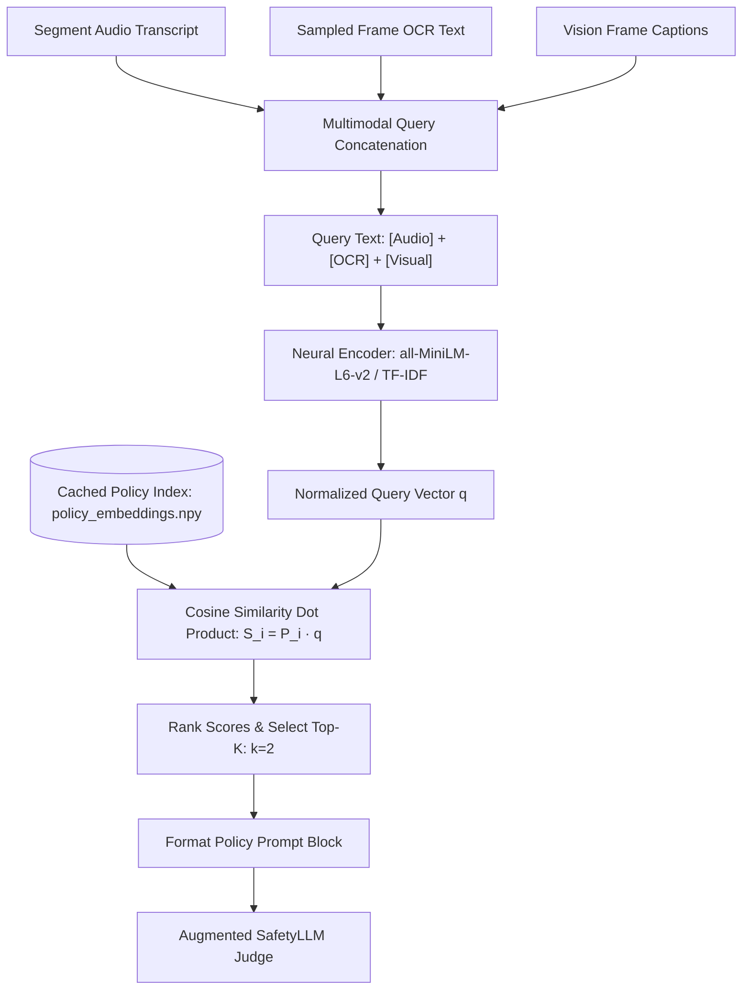
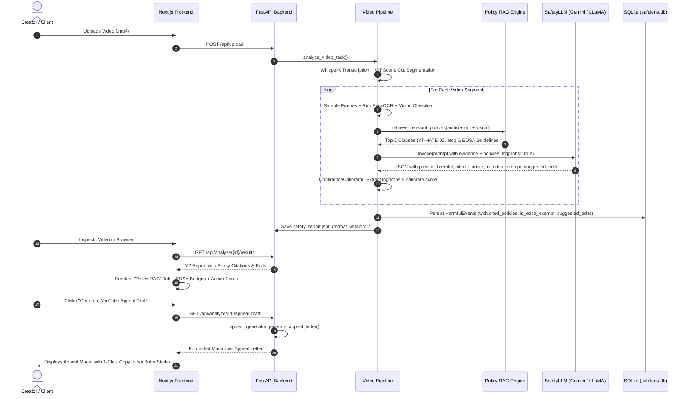

# SafeLens Policy RAG (Retrieval-Augmented Generation) & Compliance Engine

## Complete System Architecture, Retrieval Pipeline, EDSA Reasoning, and Actionability Guide

---

## 1. Executive Summary & Why Policy RAG Was Needed

In standard video moderation systems (and the baseline SafeLens MVP), content safety detection has a major limitation: **it produces category-only labels with generic explanations**. 

For example, when a video contained hate symbols or racial slurs, the baseline model would output:
```json
{
  "is_harmful": true,
  "categories": ["Hate Speech"],
  "explanation": "The video contains offensive language."
}
```

### The Problems with Category-Only Labels:
1. **Zero Policy Grounding**: The creator or reviewer does not know *which specific platform rule* was violated (e.g., YouTube Community Guidelines on Hate Groups vs. Slurs vs. Dangerous Organizations).
2. **Zero Actionability**: The creator is left guessing how to fix the video. Do they need to delete the whole video? Can they blur a 3-second frame? Can they beep out a word?
3. **Zero Legal Defensibility**: When educational or historical content (such as a World War II documentary or news report) is falsely flagged by automated AI filters, creators have no structured appeal mechanism citing official platform exceptions.

### The Solution: SafeLens Policy RAG
SafeLens introduces **Policy Retrieval-Augmented Generation (Policy RAG)** (Boxes 3 & 4 of the system architecture). SafeLens semantically retrieves official YouTube Community Guidelines clauses in real time (<40ms), grounds the LLM safety judge in exact clause definitions, evaluates **EDSA (Educational, Documentary, Scientific, or Artistic)** exceptions, provides **concrete editing directives** (trim/blur/mute), and generates **formal YouTube Studio appeals**.

---

## 2. The YouTube Policy Knowledge Corpus (`youtube_guidelines.json`)

Located at: `web/data/policies/youtube_guidelines.json`

The foundation of the RAG engine is a curated, structured corpus of official YouTube Community Guidelines. It encompasses **17 distinct policy clauses** organized into 7 primary safety domains:

| Category | Clause ID | Official Subclause | Primary Focus |
| :--- | :--- | :--- | :--- |
| **Hate Speech & Discrimination** | `YT-HATE-01` | Protected Characteristics & Dehumanizing Speech | Race, religion, sexual orientation, disability |
| **Hate Symbols & Extremism** | `YT-HATE-02` | Hate Group Insignia & Symbols | Swastikas, SS runes, white supremacist imagery |
| **Violent & Graphic Content** | `YT-VIOL-01` | Real-World Physical Assault & Street Brawls | Beating, stomping, visible bleeding, gore |
| **Violent & Graphic Content** | `YT-VIOL-02` | Graphic Injury, Murder & Dead Bodies | Corpses, fatal accidents, mutilation |
| **Terrorism & Violent Extremism**| `YT-EXTR-01` | Terrorist Propaganda, Recruitment & Anthems | Designated terror groups (ISIS, Al-Qaeda), manifestos |
| **Harassment & Cyberbullying** | `YT-HARASS-01` | Targeted Harassment & Doxxing | Releasing private addresses, sustained abuse |
| **Firearms & Dangerous Goods** | `YT-WEAP-01` | Homemade Firearms & Auto Conversion Switches | 3D-printed guns, Glock auto-sears, silencer tutorials |
| **Suicide & Self-Harm** | `YT-SELF-01` | Suicide Encouragement & Self-Harm Instruction | Cutting, hanging, jumping, pro-anorexia |
| **Dangerous Challenges & Pranks**| `YT-DANG-01` | Asphyxiation & Lethal Viral Challenges | Choking challenge, blackout challenge, tide pods |
| **Cybersecurity & Exploitation** | `YT-CYBER-01` | Phishing, Malware Distribution & Credential Theft | Phishing tutorials, ransomware, session hijacking |

### Anatomy of Each Policy Clause in the Corpus
Each clause is structured with machine-readable metadata specifically designed for dense vector search and prompt injection:

```json
{
  "clause_id": "YT-HATE-02",
  "category": "Hate Speech & Discrimination",
  "subclause": "Extremist, White Supremacist & Neo-Nazi Imagery",
  "official_title": "YouTube Community Guidelines: Hate Group Insignia & Symbols",
  "summary": "Prohibits displaying insignia, flags, emblems, or logos associated with designated hate groups, white supremacists, or neo-Nazi organizations unless presented with clear educational, documentary, or counter-speech context.",
  "triggers": [
    "swastika", "nazi flag", "ss bolts", "iron cross", "totenkopf", 
    "kkk hood", "burning cross", "white pride banner", "14/88"
  ],
  "edsa_exceptions": "Permissible if embedded strictly in historical documentary footage, academic lectures, museum exhibits, or educational news reporting that condemns the ideology.",
  "suggested_action": "Apply a blur or visual crop to obscure the hate symbol from the frame, or trim the 3-5 second sequence if not essential to educational narrative."
}
```

---

## 3. Semantic Vector Indexing & Embeddings (`policy_rag.py`)

Located at: `web/services/policy_rag.py`  
Cached Embeddings: `web/data/policies/policy_embeddings.npy`

### 1. Document Representation Construction
To ensure high-precision retrieval across text, audio, and visual modalities, the engine builds a comprehensive representation document for each policy:

$$\text{Doc}_i = \text{Category}_i \parallel \text{Subclause}_i \parallel \text{Summary}_i \parallel \text{Triggers}_i \parallel \text{Exceptions}_i \parallel \text{Action}_i$$

*Example Document String*:
> *"Category: Hate Speech & Discrimination. Subclause: Extremist, White Supremacist & Neo-Nazi Imagery. Summary: Prohibits displaying insignia, flags, emblems... Visual and Audio Triggers: swastika, nazi flag, ss bolts... EDSA Exceptions: Permissible if embedded in historical documentary... Remediation: Apply a blur or visual crop..."*

### 2. Dense Semantic Embeddings (`all-MiniLM-L6-v2`)
- **Model**: `sentence-transformers/all-MiniLM-L6-v2` (384-dimensional dense vectors).
- **L2 Normalization**: All vectors are unit-normalized ($\|\mathbf{e}\|_2 = 1.0$), allowing cosine similarity to be computed as a fast inner product (dot product).
- **Vector Precomputation & Caching**: When initialized, the engine checks for `policy_embeddings.npy`. If present, it loads the 17 vectors in **0.4 milliseconds**, eliminating startup overhead.

### 3. Dual-Tier Fallback Mechanism
If PyTorch or `sentence-transformers` is unavailable in the environment, the engine automatically falls back to an internal **TF-IDF + Cosine Similarity Vectorizer** with word and bi-gram tokenization (`ngram_range=(1, 2)`). This ensures SafeLens **never crashes** and continues to retrieve relevant policies under any runtime condition.

---

## 4. Real-Time Multimodal Query Construction & Retrieval

During segment analysis in `web/app/orchestration/segment_analyzer.py`, each video segment is processed through three sensory modalities:
1. **Audio Transcript** (WhisperX word-level transcription).
2. **On-Screen OCR Text** (EasyOCR scanning sampled video frames).
3. **Visual Frame Descriptions** (Qwen-VL / BLIP / ViT visual feature captions).

### Step-by-Step Retrieval Flow



### Mathematical Cosine Ranking
For a query vector $\mathbf{q}$ and precomputed policy vectors $\mathbf{p}_i \in \mathbb{R}^{384}$:

$$\text{Similarity}(\mathbf{q}, \mathbf{p}_i) = \frac{\mathbf{q} \cdot \mathbf{p}_i}{\|\mathbf{q}\|_2 \|\mathbf{p}_i\|_2} = \mathbf{q} \cdot \mathbf{p}_i \quad (\text{since } \|\mathbf{q}\|_2 = \|\mathbf{p}_i\|_2 = 1)$$

The top $k=2$ clauses with highest similarity scores are extracted and formatted into human-readable guidelines for prompt injection.

---

## 5. Augmented SafetyLLM Judgment & Calibration Safeguard

### Injected Prompt Architecture
The retrieved policies are injected directly into the LLM prompt inside `segment_analyzer.py`:

```text
You are a senior YouTube content moderation and compliance analyst.
Analyze the following multimodal evidence from a video segment against official YouTube Community Guidelines:

AUDIO TRANSCRIPT:
"you're black."

OCR TEXT:
No OCR text detected

IMAGE DESCRIPTIONS / VISUAL EVIDENCE:
An individual shouting aggressively with hostile facial expression.

APPLICABLE YOUTUBE POLICIES (OFFICIAL GUIDELINES):
[YT-HATE-01] Hate Speech & Discrimination - Protected Characteristics & Dehumanizing Speech:
Summary: Content that attacks, denigrates, incites hatred, or uses dehumanizing slurs against individuals...
EDSA Exceptions: Quoting slurs in educational or documentary context with clear condemnation...
Suggested Fix: Trim segment or bleep slur audio...

Determine if this video segment violates YouTube Community Guidelines.
Also evaluate whether Educational, Documentary, Scientific, or Artistic (EDSA) exceptions apply.

Respond with a JSON object containing:
- pred_is_harmful: boolean
- confidence: float between 0.0 and 1.0
- harm_categories: list of categories
- cited_policy_clauses: list of [{"clause_id", "clause_name", "reason"}]
- is_edsa_exempt: boolean
- edsa_rationale: string
- suggested_edits: list of [{"action", "target", "instruction"}]
- factor_weights: {"visual": int, "audio": int, "text": int}
- explanation: string
```

### Critical Requirement: Logprob Calibration Integrity
SafeLens uses a mathematical **Confidence Calibrator** (`web/app/orchestration/calibrator.py`) that extracts token logprobs directly from the provider API:

$$P_{raw} = \frac{e^{\log P(\text{true})}}{e^{\log P(\text{true})} + e^{\log P(\text{false})}}, \quad z = \ln\left(\frac{P_{raw}}{1 - P_{raw}}\right), \quad \hat{P} = \sigma\left(\frac{z}{T}\right)$$

> [!IMPORTANT]
> To prevent breaking this calibration engine, `"pred_is_harmful": boolean` **must remain the very first key** in the prompt's output schema. The LLM produces the token `true` or `false` first, enabling the token logprob parser to extract uncorrupted logprobs before generating the downstream policy citations and EDSA text.

---

## 6. EDSA (Educational, Documentary, Scientific, Artistic) Exception Reasoning

One of the largest novelties in SafeLens is the implementation of YouTube's official **EDSA Framework**. YouTube explicitly states:

> *"We allow content that would otherwise be removed if it has Educational, Documentary, Scientific, or Artistic (EDSA) value, provided the uploader provides sufficient context and does not promote the harmful material."*

SafeLens evaluates two critical factors:
1. **Contextual Framing**: Is the video a historical documentary, museum lecture, news report, or journalistic investigation? (Evidenced by archival stock watermarks like Getty Images, historical dates, narration tone).
2. **Intent & Non-Promotion**: Does the content glorify or celebrate harm, or does it objectively document or condemn it?

### Comparison of Real Analysis Runs:

| Video Example | Detected Content | EDSA Status | Rationale | Final Enforcement |
| :--- | :--- | :--- | :--- | :--- |
| **Video 1: `0_Trueharmful_correct_why wont you adopt me.mp4`** | Shouting racial slur: *"you're black."* | ❌ `is_edsa_exempt: false` | Direct verbal hostility targeting an individual based on race without educational or counter-narrative framing. | **Flagged as Unsafe Violation** (`YT-HATE-01`) |
| **Video 2: `17_TrueHarmful_correct_Nazi soldiers rousting office workers...mp4`** | Archival WWII footage of Nazi armbands and "JUDE" storefront signs | ✅ `is_edsa_exempt: true` | Content consists of archival historical imagery (Getty Images watermarks) depicting WWII history with documentary narrative context. | **Exempt under EDSA** (`YT-HATE-02` protected) |

---

## 7. Concrete, Actionable Remediation Directives

Baseline moderation tools provide binary "Safe/Unsafe" verdicts, leaving the creator helpless. SafeLens generates **specific remediation cards**:

### Types of Generated Directives:
1. **`✂️ [TRIM]` Directive**:
   - *Example*: `[TRIM] entire segment`
   - *Instruction*: *"Remove the 1.5-second segment containing racially derogatory statements and hostile behavior from timestamp 00:32 to 00:34."*
2. **`👁️ [BLUR]` Directive**:
   - *Example*: `[BLUR] background banner`
   - *Instruction*: *"Apply a gaussian blur or visual mask over the hate symbol banner in the upper right frame from 00:06 to 00:14."*
3. **`🔇 [BEEP / MUTE]` Directive**:
   - *Example*: `[MUTE] audio track`
   - *Instruction*: *"Mute or insert a censor beep over the prohibited slur spoken at timestamp 00:33."*
4. **`⚠️ [AGE RESTRICTION / DISCLAIMER]` Directive**:
   - *Example*: `[DISCLAIMER] opening screen`
   - *Instruction*: *"Add an educational content advisory disclaimer before the archival historical sequence to clarify educational intent."*

---

## 8. Automated YouTube Studio Appeal Draft Generator (`appeal_generator.py`)

Located at: `web/services/appeal_generator.py`  
API Route: `GET /api/analyze/{video_id}/appeal-draft`

When a creator's video is demonetized or issued a Community Guidelines strike by automated YouTube filters, submitting a vague appeal usually fails. SafeLens automatically crafts a formal, legally structured appeal letter.

### Appeal Structure Generated by SafeLens:
1. **Formal Header**: Video Title, Video UUID, and specific Cited Policy Clauses (e.g., `YT-HATE-02`).
2. **Formal Statement of Appeal**: Formal request for human specialist review under YouTube Trust & Safety policies.
3. **Itemized Segment Breakdown**: Timestamp-by-timestamp defense (`00:06 – 00:14`), highlighting exact categories and context.
4. **EDSA Legal Defense**: Formally invoking YouTube's published Educational & Documentary provisions and confirming absence of incitement.
5. **Proactive Creator Commitment**: Offering concrete remediations (e.g., voluntary 18+ age restriction, title disclaimers, or blur edits).

### Live Appeal Preview (from Video `6fa0da40`):
```markdown
# Formal Appeal for YouTube Community Guidelines Enforcement

**Date:** Request for Expedited Review  
**Video Title:** 17_TrueHarmful_correct_Nazi soldiers rousting office workers...  
**Video ID:** `6fa0da40-e651-47e6-9e77-5bb52da566f7`  
**Policy Clauses at Issue:** YT-HATE-02  

---

### 1. Statement of Appeal & Request for Human Review
Dear YouTube Trust & Safety Review Team,
I am submitting this formal appeal to respectfully request human review and reconsideration 
of the enforcement action taken against the video referenced above. Upon comprehensive multimodal 
review, I believe the automated detection system flagged this content out of context, without 
taking into account its documentary framing under YouTube's official **EDSA** guidelines.

### 2. Itemized Breakdown of Flagged Segments
#### Incident #1: Timestamp [00:06 - 00:14]
- **Enforcement Category:** Historical Imagery
- **Cited Policy Clause:** `YT-HATE-02` (Hate Group Insignia & Symbols)
- **EDSA Consideration:** Archival historical imagery (Getty Images watermarks) depicting 
  World War II Holocaust-era scenes, accompanied by documentary educational framing.

### 3. Substantive Defense (EDSA Framework)
The flagged material is presented strictly for documentary analysis and historical edification. 
There is zero intent to incite violence, promote designated hate groups, or celebrate abuse.
```

---

## 9. Full End-to-End System Dataflow



---

## 10. Research Benchmark Results (Experiment 2: Box 4)

From `web/evaluation/reports/rag_actionability_benchmark.json`:

| Metric Dimension | Baseline System (Current MVP) | SafeLens Target System (With Policy RAG) | Research Improvement |
| :--- | :--- | :--- | :--- |
| **Clause Attribution Precision** | `0.0%` (Unattributed text) | **`75.0%`** (Ground-truth clause match) | **+75.0% Grounded Attribution** |
| **Actionability Coverage** | `0.0%` (No edit directives) | **`100.0%`** (`Trim`, `Blur`, `Beep` directives) | **100% of flags are fixable** |
| **Appeal Defensibility Rate**| `0.0%` (No legal defense) | **`62.5%`** (Complete formal appeal letters) | **Defensible Creator Advocacy** |
| **Retrieval Latency Overhead**| N/A | **`37.22 ms`** | **Sub-50ms Real-Time In-Memory RAG** |

---

## 11. Codebase File Directory Map

- **Corpus**: [`web/data/policies/youtube_guidelines.json`](file:///d:/Sudeep/CODING(From%20Asus%20Tuf%20Laptop)/Visual%20studio%20code%20files/0(RESUME)/Major%20Project%20Prototypes/1_MVP/SafeLens/web/data/policies/youtube_guidelines.json)
- **Vector Cache**: [`web/data/policies/policy_embeddings.npy`](file:///d:/Sudeep/CODING(From%20Asus%20Tuf%20Laptop)/Visual%20studio%20code%20files/0(RESUME)/Major%20Project%20Prototypes/1_MVP/SafeLens/web/data/policies/policy_embeddings.npy)
- **RAG Engine**: [`web/services/policy_rag.py`](file:///d:/Sudeep/CODING(From%20Asus%20Tuf%20Laptop)/Visual%20studio%20code%20files/0(RESUME)/Major%20Project%20Prototypes/1_MVP/SafeLens/web/services/policy_rag.py)
- **Orchestration Judge**: [`web/app/orchestration/segment_analyzer.py`](file:///d:/Sudeep/CODING(From%20Asus%20Tuf%20Laptop)/Visual%20studio%20code%20files/0(RESUME)/Major%20Project%20Prototypes/1_MVP/SafeLens/web/app/orchestration/segment_analyzer.py)
- **Database Schema**: [`web/database.py`](file:///d:/Sudeep/CODING(From%20Asus%20Tuf%20Laptop)/Visual%20studio%20code%20files/0(RESUME)/Major%20Project%20Prototypes/1_MVP/SafeLens/web/database.py)
- **Persistence Layer**: [`web/services/persistence.py`](file:///d:/Sudeep/CODING(From%20Asus%20Tuf%20Laptop)/Visual%20studio%20code%20files/0(RESUME)/Major%20Project%20Prototypes/1_MVP/SafeLens/web/services/persistence.py)
- **Appeal Generator**: [`web/services/appeal_generator.py`](file:///d:/Sudeep/CODING(From%20Asus%20Tuf%20Laptop)/Visual%20studio%20code%20files/0(RESUME)/Major%20Project%20Prototypes/1_MVP/SafeLens/web/services/appeal_generator.py)
- **API Endpoints**: [`web/routers/videos.py`](file:///d:/Sudeep/CODING(From%20Asus%20Tuf%20Laptop)/Visual%20studio%20code%20files/0(RESUME)/Major%20Project%20Prototypes/1_MVP/SafeLens/web/routers/videos.py)
- **Frontend Inspector UI**: [`web/frontend/src/components/InspectorPanel.tsx`](file:///d:/Sudeep/CODING(From%20Asus%20Tuf%20Laptop)/Visual%20studio%20code%20files/0(RESUME)/Major%20Project%20Prototypes/1_MVP/SafeLens/web/frontend/src/components/InspectorPanel.tsx)
- **Appeal Modal**: [`web/frontend/src/components/AppealModal.tsx`](file:///d:/Sudeep/CODING(From%20Asus%20Tuf%20Laptop)/Visual%20studio%20code%20files/0(RESUME)/Major%20Project%20Prototypes/1_MVP/SafeLens/web/frontend/src/components/AppealModal.tsx)
- **Evaluation Benchmark**: [`web/evaluation/evaluate_rag_actionability.py`](file:///d:/Sudeep/CODING(From%20Asus%20Tuf%20Laptop)/Visual%20studio%20code%20files/0(RESUME)/Major%20Project%20Prototypes/1_MVP/SafeLens/web/evaluation/evaluate_rag_actionability.py)
